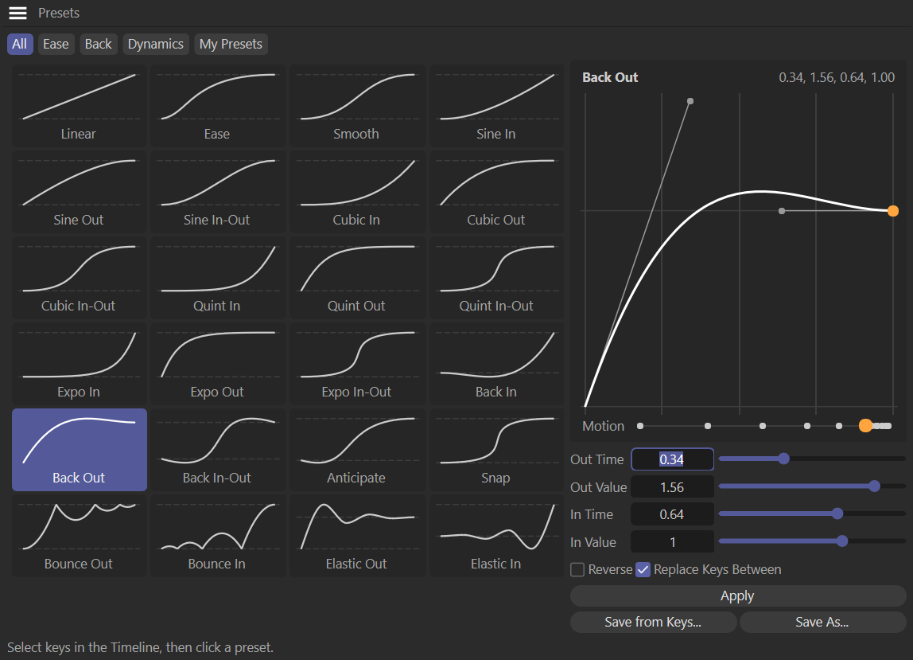
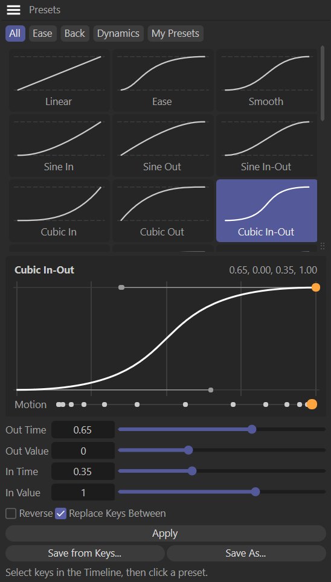

# Plankton Ease for Cinema 4D

A preset library for animation curves: easing, back, bounce and elastic presets that
you apply to selected keys, copy and paste of eases between keys, plus your own
saved curves.

Version 2.1, written for and tested in Cinema 4D 2027 (Python 3.11).

| Wide: settings beside the presets | Narrow or docked: settings below |
| --- | --- |
|  |  |

## Install

1. Download `plankton_ease_2.1.zip` from the
   [latest release](https://github.com/Studio-Plankton/c4d-ease-presets/releases/latest)
   and unpack it. It holds one folder, `ease_presets`.
2. In Cinema 4D, open **Edit > Preferences** and click **Open Preferences Folder**.
   Then close Cinema 4D.
3. Copy the `ease_presets` folder into the `plugins` folder of that preferences folder.
4. Start Cinema 4D, then **Extensions > Plankton Ease**.

To update, replace the `ease_presets` folder with the new one. Your own presets are
stored outside it and stay.

Dock the window anywhere and save the layout: it reflows to the space it gets.

## Use

- Select two or more keys in the Timeline (Dope Sheet or F-Curve), or select an
  animated object to affect all of its key segments.
- Click a tile to preview it, then press **Apply**. Double-click applies in one go.
  Right-click a tile for Apply, Save As, Rename and Delete.
- Every pair of neighbouring selected keys gets the preset. Ctrl+Z undoes it.
- Bezier presets only change tangents. Bounce and Elastic insert keys between the two
  keys. To re-apply, select the first and last key again: **Replace Keys Between**
  clears the keys that were inserted before.
- Tweak before applying:
  - Bezier: Out Time, Out Value, In Time, In Value (the two tangent handles).
  - Bounce and Elastic: Amplitude, Count, Decay (size of the last bounce compared to
    the first; 1 = no decay).
  - **Reverse** turns an ease-out into an ease-in and back.
- Click the chart to replay the motion.

## Copy and paste an ease

- **Copy Ease**: select two keys (their ease) or a run of three or more keys (the whole
  curve shape) and press Copy Ease. The copied ease shows in the chart.
- **Paste Ease**: select the target keys and press Paste Ease. Every pair of
  neighbouring selected keys gets the copied ease, scaled to its own duration and
  value change. It follows the **Replace Keys Between** checkbox.
- Both work in the Dope Sheet and in F-Curve mode. The copied ease is kept until
  Cinema 4D quits; use **Save As** to keep it as a preset.
- **Shortcuts**: Copy Ease and Paste Ease are also separate commands in the
  Extensions menu, so they work with the window closed. Give them shortcuts in
  **Edit > Customize Commands** (search for "Ease"), or drag them into a palette.
  Their messages then show in the status bar of Cinema 4D.

## Window

- Tabs filter the library: All, Ease, Back, Dynamics, My Presets.
- The tiles add and remove columns as the window changes width.
- A wide window puts the settings beside the tiles; a narrow one puts them below.
- Drag the divider between the tiles and the settings to resize them (sideways when
  side by side, up and down when stacked). The chart fills its section, so a bigger
  section means a bigger chart. It is Cinema 4D's own divider, and the split is
  remembered for each of the two layouts.
- All colours come from the Cinema 4D interface scheme, so the window follows the
  theme and any colours changed in Preferences.

## Your own presets

- **Save from Keys**: select 2 keys (saves their easing) or a run of 3 or more keys
  (saves the whole curve shape, up to 200 keys).
- **Save As**: saves the current slider settings as a new preset.
- User presets live in `ease_presets_user.json` in the Cinema 4D preferences folder
  (Presets > Show Preset File). Copy that file to share presets with the team, then
  use Presets > Reload Preset File.
- The file is checked when it is read: values are clamped to safe ranges and entries
  that are not valid are skipped, with a count in the status line.

## Notes

- The status line warns when Cinema 4D shaped a curve differently from the preset.
- The plugin IDs are registered with Maxon (1074269 "EasePresets", 1074280
  "EasePresetsCopy", 1074281 "EasePresetsPaste"), so the plugin can be shared outside
  the studio.
- The plugin folder and the preset file keep the name `ease_presets`, so updating
  from 2.0 keeps your presets.
- The plugin reads and writes only its preset file and its own window sizes in the
  Cinema 4D preferences. It makes no network connections.

## Development

Link the repo folder into the preferences `plugins` folder instead of copying it, so
edits are picked up at the next start of Cinema 4D (PowerShell):

```powershell
New-Item -ItemType Junction -Path "$env:APPDATA\Maxon\<your C4D prefs folder>\plugins\ease_presets" -Target "<repo>\ease_presets"
```

## Licence

MIT, see [LICENSE](LICENSE).
